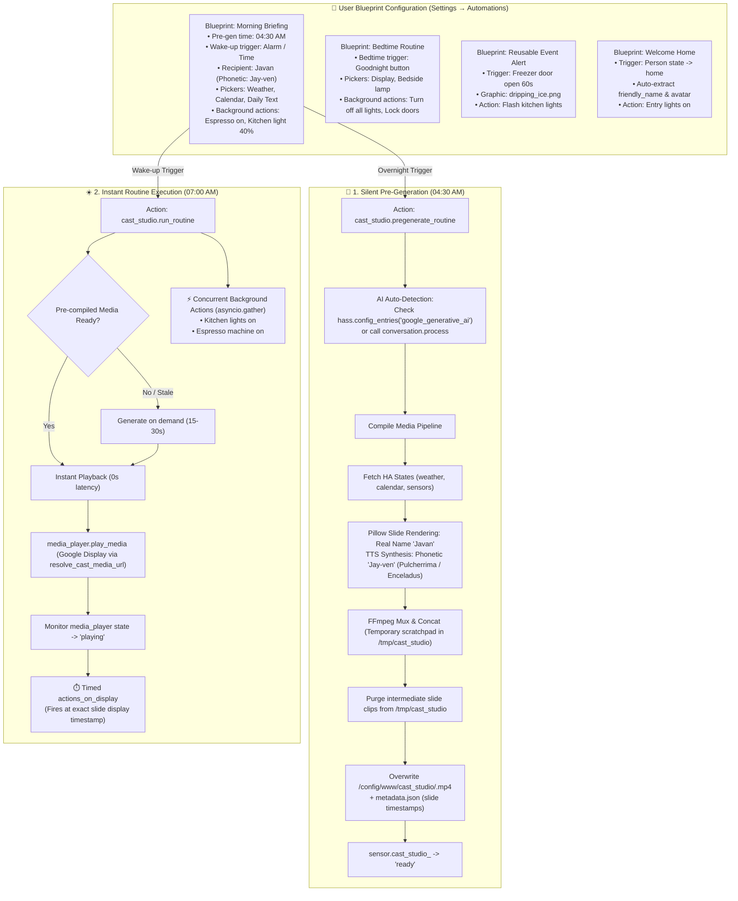

# Design Specification: CastStudio (`ha-cast-studio`)

**Repository Name:** `ha-cast-studio`  
**Integration Domain:** `cast_studio`  
**Target Platform:** Home Assistant Core / Supervised / OS 2024.6.0+ (HACS Custom Integration)  
**Author / Codeowner:** Javan Dicks ([@javand](https://github.com/javand))  
**Document Status:** Approved Design  
**Created:** October 17, 2026  

---

## 1. Executive Summary & Problem Statement

Home Assistant users often want synchronized, multi-sensory routines (morning briefings, bedtime wind-downs, leaving home, arriving home) that combine:
- High-contrast visual slides and graphics rendered for smart displays (e.g., Google Nest Hub 7").
- Personalized spoken narration with proper phonetic name pronunciation and dual-voice personalities.
- Physical device actions (adjusting lights, climate, locks, switches).

Previously, compiling multi-slide briefing media required external host scripts or editing complex YAML files by hand, while forcing users to register separate API keys and secrets. Furthermore, compiling dynamic video takes 15–30 seconds, causing an unacceptable delay if generated on-demand at wake-up.

**The Solution:** Build **`CastStudio`** (`cast_studio`), an autonomous, native Home Assistant custom integration featuring:
1. **3-Tier Production Architecture:**
   - **Static Reusable Clips (0s latency):** Pre-compiled permanent alert MP4s (e.g. freezer door left open, leak alert, garage open) with static or custom graphic icons.
   - **Pre-Generated Daily Shows (0s wake-up latency):** Silently pre-compiles media overnight (04:30 AM) so morning and bedtime shows start instantly.
   - **On-Demand Dynamic Greetings:** On-the-fly personalized arrival greetings (`welcome_home.yaml`) with avatar composition.
2. **Blueprint-First UI Setup:** Ships 4 pre-packaged automation blueprints (`blueprints/automation/cast_studio/`) allowing users to configure complete routines 100% through Home Assistant's visual UI.
3. **Zero-Credential AI Auto-Detection:** Automatically discovers existing Home Assistant AI integrations (such as the official `google_generative_ai` config entry) or routes through native `conversation.*` agents (`conversation.process`), eliminating the need for users to re-enter API keys.
4. **Decoupled Pre-generation:** Silently pre-compiles media ahead of time without waking the house or touching devices, enabling instant, zero-latency playback when triggers occur.
5. **Action Partitioning:** Non-visual background actions (espresso machines, lights, locks) fire concurrently in parallel (`asyncio.gather`), while visual-linked actions execute at the precise moment their slide appears during playback.
6. **Strict Identity Contract:** Visual cards render the user's real name (`name`, e.g. "Javan"), while TTS narration scripts use the phonetic spelling (`phonetic_name`, e.g. "Jay-ven") so speech synthesis pronounces it perfectly.
7. **Mindful Storage Management:** Overwrites target media files by default (`/config/www/cast_studio/<routine>.mp4` and `/config/www/cast_studio/static/<clip>.mp4`), purges scratch clips immediately upon concatenation, and prunes residual dynamic files older than 24 hours while permanently preserving static clips.
8. **Local FFmpeg & Cast Playback:** Generates standard 1024x600 MP4s using Pillow and HA's local FFmpeg binary, casting seamlessly to Google Cast displays via resolved HTTP network URLs (`http://<ha-ip>:8123/local/...`).

---

## 2. System Architecture & Lifecycle Workflow



---

## 3. Blueprint Specification & User Experience

Blueprints are stored under `blueprints/automation/cast_studio/`:

1. **`morning_briefing.yaml`** (Daily Morning Show):
   - 7-step morning briefing sequence (`greeting` → `weather` → `national_day` → `fun_fact` → `agenda` → `commute` → `scripture`; the built-in default routine adds `daily_encouragement`), overnight pregeneration schedule (04:30 AM), wake trigger, display audio preparation, dual-voice personas, concurrent smart home actions, and `post_briefing_actions` Lovelace dashboard cast hand-off.
2. **`bedtime_routine.yaml`** (Daily Evening Wind-Down):
   - Evening trigger, bedtime voice styling, bedside display dimming, and concurrent shutdown actions.
3. **`event_alert.yaml`** (Reusable Static Visual Alert):
   - Pre-compiles permanent alert video (`/config/www/cast_studio/static/<clip>.mp4`), fires immediately upon trigger with zero rendering delay.
4. **`welcome_home.yaml`** (Personalized Contextual Arrival):
   - Monitors `person_entity` state transitioning to `home`, extracts `friendly_name` and `entity_picture`, and plays a personalized welcome greeting on smart displays.

---

## 4. Custom Integration Directory Structure

```
ha-cast-studio/
├── blueprints/
│   └── automation/
│       └── cast_studio/
│           ├── morning_briefing.yaml # Morning briefing blueprint (7-step briefing + Lovelace hand-off)
│           ├── bedtime_routine.yaml  # Bedtime routine blueprint
│           ├── event_alert.yaml      # Static reusable alert blueprint
│           └── welcome_home.yaml     # Welcome home arrival blueprint
├── custom_components/
│   └── cast_studio/
│       ├── brand/                    # HA Brands compliant icons and logos
│       ├── assets/                   # Bundled graphics (dripping_ice, door_alert, avatar)
│       ├── __init__.py               # Setup, services, reload, and entry management
│       ├── helpers.py                # Shared async task tracking and executor utilities
│       ├── manifest.json             # Integration metadata & dependencies
│       ├── const.py                  # Domain constants, defaults, voice mappings
│       ├── config_flow.py            # Optional UI config flow (override keys / recipient profile)
│       ├── orchestrator.py           # Routine executor, action partitioner, and Cast sync
│       ├── generator.py              # Core video, static clip, TTS, and slide engine
│       ├── slide_renderer.py         # Pillow image layout & typography renderer (real name)
│       ├── tts_client.py             # Dual-voice TTS synthesizer (phonetic pronunciation)
│       ├── ai_client.py              # AI client with auto-detection & conversation agent support
│       ├── ffmpeg_runner.py          # Native FFmpeg subprocess executor
│       ├── storage_manager.py        # Scratch cleanup & retention pruner (preserves static/)
│       ├── sensor.py                 # Status entities: sensor.cast_studio_<routine>
│       ├── services.yaml             # Service definitions (run_routine, pregenerate, compile_clip)
│       └── strings.json              # UI localization strings
├── tests/
│   ├── conftest.py                   # Pytest fixtures and mocks
│   ├── test_config_flow.py           # Config flow unit tests
│   ├── test_ai_autodetect.py         # Credentials auto-detection tests
│   ├── test_orchestrator.py          # Action partitioning & Cast sync tests
│   ├── test_generator.py             # Video generator and static clip tests
│   ├── test_slide_renderer.py        # Pillow layout & image composition tests
│   ├── test_storage_manager.py       # Cleanup, overwrite, and static retention tests
│   ├── test_tts_client.py            # TTS API mocking tests
│   ├── test_services.py              # Services and sensor lifecycle tests
│   └── test_blueprints.py            # 4-blueprint suite schema validation tests
├── hacs.json                         # HACS integration metadata
├── pyproject.toml                    # Build configuration
├── LICENSE                           # MIT License
└── README.md                         # Installation & usage documentation
```

---

## 5. Technical Specifications

### 5.1. Integration Manifest (`manifest.json`)
```json
{
  "domain": "cast_studio",
  "name": "CastStudio",
  "codeowners": ["@javand"],
  "config_flow": true,
  "dependencies": ["ffmpeg"],
  "documentation": "https://github.com/javand/ha-cast-studio",
  "integration_type": "service",
  "iot_class": "cloud_polling",
  "issue_tracker": "https://github.com/javand/ha-cast-studio/issues",
  "requirements": [],
  "version": "0.1.0"
}
```

### 5.2. Service Definitions (`services.yaml`)
1. **`cast_studio.run_routine`**: Executes a multimedia routine or static clip with instant playback, cache-busting timestamping (`?v=<timestamp>`), pre-playback display unmuting/volume preparation, and optional `post_routine_actions` hook.
2. **`cast_studio.pregenerate_routine`**: Silently compiles media ahead of time with companion `post_routine_actions`.
3. **`cast_studio.compile_clip`**: Compiles a static reusable alert video clip directly into `/config/www/cast_studio/static/<clip_name>.mp4`.
4. **`cast_studio.reload`**: Reloads integration configuration and resets routine sensors.

### 5.3. Visual Themes, Weather-Aware Gradients & Badges
`slide_renderer.py` provides responsive visual themes and header badge pills:
- **Themes (`SLIDE_THEMES`):** `morning`, `weather_sunny`, `weather_rainy`, `weather_snow`, `weather_cloudy`, `calendar`, `evening`, `scripture`.
- **Weather Condition Adaptive Gradients:** Automatically selects deep slate/indigo for rainy/stormy conditions, frosted icy blues for snow/sleet, muted blue-greys for overcast/wind, and warm dawn palettes for clear/sunny forecasts.
- **Category Badge Pills:** Renders translucent badge pills (e.g. `GREETING`, `FORECAST`, `COMMUTE`, `SCHEDULE`, `TASKS`, `SCRIPTURE`, `WIND DOWN`) in the top left header above the card title.

### 5.4. Live Service Extraction & Commute Comparisons
- **`weather.get_forecasts` Extraction:** Evaluates modern Home Assistant 2024.6+ service responses to extract live forecast temperatures and conditions without relying on deprecated entity state attributes.
- **Multi-Sensor Commute Comparison:** Automatically compares multiple travel sensors (e.g., `sensor.drive_travel_time` vs `sensor.metro_travel_time`) and computes the delta, reporting which option is faster and by how many minutes.
- **Transportation Mode Selection:** The mode is resolved as routine/service `transportation_mode` > step `transportation_mode` (alias `mode_override`) > integration option `default_transportation_mode` > `fastest`. `fastest` picks the lower of driving and transit times; `driving` and `transit` force that mode when its sensor has data, otherwise the available one is used. The `run_routine` and `pregenerate_routine` services accept `transportation_mode` and merge it into the routine config. `run_routine` with `transportation_mode` bypasses cached pregenerated media and compiles fresh.
- **Google Maps Route Map:** The optional `maps_api_key` option (config flow and options flow, password field) is resolved from the CastStudio entry, then `secrets.yaml`, `google_travel_time`/`google_maps` entries, and `hass.data`. `async_fetch_commute_map` calls the Directions API (origin `zone.home`, else `hass.config` latitude/longitude; destination from step `destination_zone`, the `commute_destination_zone` option, the drive sensor's `destination` attribute as a zone id or `"lat,lon"`, then `zone.work`/`zone.office`, with no hardcoded fallback; with no destination the fetch is skipped) and the Static Maps API (`size=512x300` at scale 2, i.e. 1024x600 within Google's 640x640 limit, dark style, polyline and H/W markers), caching `commute_map_<mode>_<date>.png` under `<output_dir>/cache`. On a missing key, HTTP error, non-OK status or timeout it returns `None` and `slide_renderer.py` draws a local dark grid map instead; commute times still come from the sensors.
- **Commute ETA & HUD:** Live `run_routine` compiles show a timezone-aware clock ETA ("Arrive around 7:35 AM", HA local time). `pregenerate_routine` compiles a relative trip length ("35 min trip", narration "about 35 minutes") because the media plays hours later. When no travel time is known the ETA is empty, not "0 min". The selected mode, route and ETA are injected into the narration context as "Commute (tell the listener)". Comparison chips appear only when both modes have a time; every HUD label (subtitle, chips, ETA row) is ellipsized to stay inside the 1024 px canvas.
- **Weather Preparation Advisory:** `compute_weather_advisory` yields one tip in priority order: poor air quality (AQI above 100), umbrella (precipitation probability of 30% or more, or rain/storm/pour/drizzle/lightning/shower condition), warm coat (temperature at most 50F or high at most 55F), light jacket (temperature at most 65F or low at most 50F), dress light (85F or above), otherwise "Comfortable weather expected today" (Celsius is converted). It is stored as `weather_data["advisory"]`, drawn as a chip under High/Low on the weather slide, and injected into the narration context as "Weather Advisory".
- **Current Date Injection:** AI prompts are injected with the exact local day-of-week and date (`Current Local Date: Saturday, October 17, 2026`) for temporal accuracy in greeting, calendar, and fun fact / National Day narrations.

### 5.4.1. Daily Encouragement & Dynamic Backgrounds
- **`daily_encouragement` Step:** Follows `scripture` in the default morning routine built in `__init__.py` (the `morning_briefing.yaml` blueprint is still the 7-step sequence). Given scripture/daily text, the AI returns a calm one-sentence title and exactly 2 practical takeaways (`<Bold lead>: <short sentence>`) in plain language with no religious jargon. With no text it uses a short general good-day remark (title plus at most 2 bullets, narration under 30 words). The step always runs, and narration is forced to end with "Have a great day, <Name>!" (phonetic name for TTS, real name on screen). Only a final sentence that is wholly a generic send-off ("I hope you have a wonderful day!") is replaced; any other ending is kept and the sign-off is appended as a new sentence.
- **Rendering:** `slide_renderer.py` draws a reusable frosted takeaway card (pill, headline, bullets, divider, footer) over a procedural local dawn gradient. No AI image is requested for this slide.
- **Dynamic AI Backgrounds (Imagen):** `DYNAMIC_IMAGE_STEP_KEYS` limits generation to `greeting` (regenerated every run), `fun_fact` (prompt grounded in the fact) and `national_day` (prompt grounded in the holiday). All other slides are static unless the step sets `dynamic_image: true` (or `image_mode: dynamic`); `static`, `image_path` or `icon_path` force static. If generation fails, the static asset is used.

### 5.5. Voice Personas & Custom Registration
- **Built-in Personas:** `morning_host`, `news_anchor`, `upbeat_energetic`, `conversational`, `life_coach`, `calm_reassuring`, `soothing`, `meditative`, `reverent`, `warm_uplifting`.
- **Runtime Registration:** Third-party extensions can register custom speaking profiles dynamically via `tts_client.register_personality_prompt(name, prompt)`.
