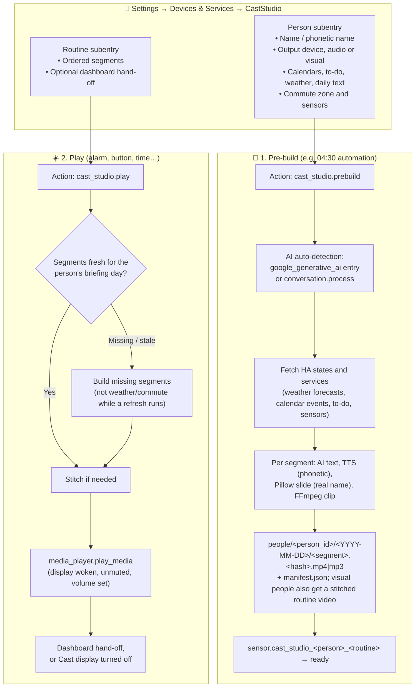

# Design Specification: CastStudio (`ha-cast-studio`)

**Repository Name:** `ha-cast-studio`  
**Integration Domain:** `cast_studio`  
**Target Platform:** Home Assistant Core / Supervised / OS 2025.8.0+ (HACS Custom Integration)  
**Author / Codeowner:** Javan Dicks ([@javand](https://github.com/javand))  
**Document Status:** Approved Design  
**Created:** October 17, 2026  

---

## 1. Executive Summary & Problem Statement

Households want a morning briefing that is personal to each person: their weather, calendars, commute and daily text, spoken with their name pronounced correctly, on the display or speaker in the room they are in. Compiling narrated video takes 15–30 seconds, which is too long to wait for at wake-up.

**The Solution:** **`CastStudio`** (`cast_studio`), a native Home Assistant custom integration featuring:
1. **People and routines in the integration UI:** each person (name, pronunciation, output device, audio or visual output, calendars, commute sensors, voices) and each of their routines (an ordered list of segments) is a config subentry. There are no blueprints and no YAML.
2. **Pre-build, then play instantly:** `cast_studio.prebuild` builds and stores a person's segments ahead of time; `cast_studio.play` plays a routine at once from any automation trigger. `cast_studio.refresh` rebuilds only the dynamic segments (weather, commute) shortly before a play, so they are current; nothing is rebuilt at play time unless missing or stale.
3. **Zero-Credential AI Auto-Detection:** reuses the API key of an existing `google_generative_ai` config entry, or routes through a native `conversation.*` agent. Account problems (billing, key, quota) surface as a sensor attribute and a Repairs issue.
4. **Strict Identity Contract:** slides render the real name (`name`, e.g. "Alex"); narration uses the phonetic spelling and pronunciation lists, at speech time only.
5. **Local FFmpeg & Cast Playback:** 1024x600 slides drawn with Pillow, encoded with HA's FFmpeg, and cast to Google Cast devices over resolved network URLs (`http://<ha-ip>:8123/local/...`).

---

## 2. System Architecture & Lifecycle Workflow



---

## 3. User Experience

- **Add person** and **Add routine** on the CastStudio entry configure everything (see §5.6 and the README).
- Automations call `cast_studio.prebuild` and `cast_studio.play`; the README gives examples for a 04:30 pre-build, a phone-alarm wake-up, a button with single and double press, and weekday-specific routines.

---

## 4. Custom Integration Directory Structure

```
ha-cast-studio/
├── custom_components/
│   └── cast_studio/
│       ├── brand/                    # HA Brands compliant icons and logos
│       ├── assets/                   # Bundled fallback artwork
│       ├── __init__.py               # Setup, prebuild/play actions, v1 → v2 migration
│       ├── briefing.py               # Prebuild, play, stitching, play history, sensors
│       ├── segments.py               # Per-segment build and storage per person and day
│       ├── people.py                 # Person and routine subentries, briefing day
│       ├── play_history.py           # Played segment types per person and day
│       ├── pronunciation.py          # Household and per-person speech respelling
│       ├── generator.py              # Entity context, AI content, single-step slide/audio build
│       ├── orchestrator.py           # Cast playback, slide sync, dashboard hand-off
│       ├── slide_renderer.py         # Pillow layout & typography renderer (real name)
│       ├── tts_client.py             # Dual-voice TTS synthesizer (phonetic pronunciation)
│       ├── ai_client.py              # AI client with auto-detection & conversation agent support
│       ├── ai_health.py              # AI account problem tracking (sensor attribute, Repairs)
│       ├── ffmpeg_runner.py          # Native FFmpeg subprocess executor
│       ├── helpers.py                # Shared async task tracking and executor utilities
│       ├── sensor.py                 # sensor.cast_studio_<person>_<routine> (status)
│       ├── config_flow.py            # Entry, options, person and routine flows
│       ├── const.py                  # Domain constants and defaults
│       ├── services.yaml             # prebuild, refresh, play and the announcement actions
│       └── strings.json              # UI localization strings
├── tests/                            # pytest suite (pytest-homeassistant-custom-component)
├── hacs.json                         # HACS integration metadata
├── LICENSE                           # MIT License
└── README.md                         # Installation & usage documentation
```

---

## 5. Technical Specifications

### 5.1. Integration Manifest (`manifest.json`)
```json
{
  "domain": "cast_studio",
  "name": "CastStudio",
  "codeowners": ["@javand"],
  "config_flow": true,
  "dependencies": ["ffmpeg"],
  "documentation": "https://github.com/javand/ha-cast-studio",
  "integration_type": "service",
  "iot_class": "cloud_polling",
  "issue_tracker": "https://github.com/javand/ha-cast-studio/issues",
  "requirements": [],
  "version": "0.1.0"
}
```

### 5.2. Actions (`services.yaml`)
1. **`cast_studio.prebuild`**: builds and stores a routine's segments, or the union of a person's routines, without playing.
2. **`cast_studio.refresh`**: rebuilds only the dynamic segments (weather, commute) of a routine, or of every routine of a person that has them, even when fresh. Visual routines in scope get their stitched files re-stored.
3. **`cast_studio.play`**: plays a routine now from fresh stored segments, building anything missing or stale first. Cache-busting (`?v=<timestamp>`) and display unmute/volume preparation are applied.

### 5.3. Visual Themes, Weather-Aware Gradients & Badges
`slide_renderer.py` provides responsive visual themes and header badge pills:
- **Themes (`SLIDE_THEMES`):** `morning`, `weather_sunny`, `weather_rainy`, `weather_snow`, `weather_cloudy`, `calendar`, `evening`, `scripture`.
- **Weather Condition Adaptive Gradients:** Automatically selects deep slate/indigo for rainy/stormy conditions, frosted icy blues for snow/sleet, muted blue-greys for overcast/wind, and warm dawn palettes for clear/sunny forecasts.
- **Category Badge Pills:** Renders translucent badge pills (e.g. `GREETING`, `FORECAST`, `COMMUTE`, `SCHEDULE`, `TASKS`, `SCRIPTURE`, `WIND DOWN`) in the top left header above the card title.

### 5.4. Live Service Extraction & Commute Comparisons
- **`weather.get_forecasts` Extraction:** Evaluates modern Home Assistant 2024.6+ service responses to extract live forecast temperatures and conditions without relying on deprecated entity state attributes.
- **Multi-Sensor Commute Comparison:** Automatically compares multiple travel sensors (e.g., `sensor.drive_travel_time` vs `sensor.metro_travel_time`) and computes the delta, reporting which option is faster and by how many minutes.
- **Transportation Mode Selection:** Each person's travel mode (`fastest`, `driving` or `transit`). `fastest` picks the lower of driving and transit times; `driving` and `transit` use only that mode's sensor.
- **Google Maps Route Map:** The optional `maps_api_key` option (config flow and options flow, password field) is resolved from the CastStudio entry, then `secrets.yaml`, `google_travel_time`/`google_maps` entries, and `hass.data`. `async_fetch_commute_map` calls the Directions API (origin `zone.home`, else `hass.config` latitude/longitude; destination from the person's work zone, the drive sensor's `destination` attribute as a zone id or `"lat,lon"`, then `zone.work`/`zone.office`, with no hardcoded fallback; with no destination the fetch is skipped) and the Static Maps API (`size=512x300` at scale 2, i.e. 1024x600 within Google's 640x640 limit, dark style, polyline and H/W markers), caching `commute_map_<mode>_<date>.png` under `<output_dir>/cache`. On a missing key, HTTP error, non-OK status or timeout it returns `None` and `slide_renderer.py` draws a local dark grid map instead; commute times still come from the sensors.
- **Commute ETA & HUD:** Briefing segments show a relative trip length ("35 min trip", narration "about 35 minutes") rather than a clock arrival time, because stored content can play later than it was built. When no travel time is known the ETA is empty, not "0 min". The selected mode, route and ETA are injected into the narration context as "Commute (tell the listener)". Comparison chips appear only when both modes have a time; every HUD label (subtitle, chips, ETA row) is ellipsized to stay inside the 1024 px canvas.
- **Weather Preparation Advisory:** `compute_weather_advisory` yields one tip in priority order: poor air quality (AQI above 100), umbrella (precipitation probability of 30% or more, or rain/storm/pour/drizzle/lightning/shower condition), warm coat (temperature at most 50F or high at most 55F), light jacket (temperature at most 65F or low at most 50F), dress light (85F or above), otherwise "Comfortable weather expected today" (Celsius is converted). It is stored as `weather_data["advisory"]`, drawn as a chip under High/Low on the weather slide, and injected into the narration context as "Weather Advisory".
- **Current Date Injection:** AI prompts are injected with the exact local day-of-week and date (`Current Local Date: Saturday, October 17, 2026`) for temporal accuracy in greeting, calendar, and fun fact / National Day narrations.

### 5.4.1. Daily Encouragement & Dynamic Backgrounds
- **`daily_encouragement` Step:** Usually follows `scripture` in a routine. Given scripture/daily text, the AI returns a calm one-sentence title and exactly 2 practical takeaways (`<Bold lead>: <short sentence>`) in plain language with no religious jargon. With no text it uses a short general good-day remark (title plus at most 2 bullets, narration under 30 words). The step always runs, and narration is forced to end with "Have a great day, <Name>!" (phonetic name for TTS, real name on screen). Only a final sentence that is wholly a generic send-off ("I hope you have a wonderful day!") is replaced; any other ending is kept and the sign-off is appended as a new sentence.
- **Rendering:** `slide_renderer.py` draws a reusable frosted takeaway card (pill, headline, bullets, divider, footer) over a procedural local dawn gradient. No AI image is requested for this slide.
- **Dynamic AI Backgrounds (Imagen):** `DYNAMIC_IMAGE_STEP_KEYS` limits generation to `greeting`, `fun_fact` (prompt grounded in the fact), `national_day` (prompt grounded in the holiday) and `closing` (weekday and season). All other slides are static unless the step sets `dynamic_image: true` (or `image_mode: dynamic`); `static`, `image_path` or `icon_path` force static. If generation fails, the static asset is used.

### 5.5. Voice Personas & Custom Registration
- **Built-in Personas:** `morning_host`, `news_anchor`, `upbeat_energetic`, `conversational`, `life_coach`, `calm_reassuring`, `soothing`, `meditative`, `reverent`, `warm_uplifting`.
- **Runtime Registration:** Third-party extensions can register custom speaking profiles dynamically via `tts_client.register_personality_prompt(name, prompt)`.

### 5.6. Multi-Person Briefings (as built)
- **Config model:** `person` and `routine` config subentries of the CastStudio entry (`people.py`). Person fields: `name`, `phonetic_name`, `media_player`, `output_format` (`audio`|`visual`, default `visual`), `commute_destination_zone`, `transportation_mode` (default `fastest`), `reset_time` (default `03:00:00`), `max_age_minutes` (default `0`, no age check), plus advanced settings (entities, `calendar_entities` (any number; an older single `calendar_entity` is still read), `commute_drive_sensor`, `commute_transit_sensor`, optional evening `commute_drive_return_sensor`/`commute_transit_return_sensor` (trip home and round-trip total for the selected mode), voices, personalities, `conversation_agent`, greeting title/subtitle/image, `pronunciations`). Routine fields: `person_id`, `name` (unique per person), ordered `segments`, and optional `dashboard_path`, `dashboard_view`, `dashboard_display`. The form picks the dashboard and view in one dropdown (`<url_path>[/<view>]`, listed from the Lovelace dashboards and their views) and stores them as `dashboard_path` and `dashboard_view`. The routine form stores segments in submitted order.
- **Segments:** `greeting`, `weather`, `national_day`, `fun_fact`, `agenda`, `commute`, `scripture`, `daily_encouragement`, `closing`. A `closing` segment makes the encouragement build without its own sign-off; its slide is a full-bleed photo (dynamic AI image from a weekday/season prompt, fallback `closing_good_day.jpg`) with a `Happy <Weekday>!` tag. Person commute sensors are refreshed with `homeassistant.update_entity` (15 s cap, 5 s during `cast_studio.refresh`) before they are read. `weather` and `commute` are the dynamic segment types (`DYNAMIC_SEGMENT_TYPES`): `cast_studio.refresh` rebuilds them; `async_play` never rebuilds them when a stored copy exists. Each dynamic segment stands alone: one that fails to refresh keeps its stored copy. Every segment build logs its duration and source (`prebuild`, `refresh`, `play`) at INFO. Segments are stored per person and briefing day under `people/<person_id>/<YYYY-MM-DD>/`. **Voice fallback:** a Gemini or OpenAI voice request that times out, or fails with a network or 5xx error, is retried once after one second before the voice falls back to Home Assistant TTS (a 4xx is not retried). A segment voiced by the fallback voice is stored with `degraded: true` in the manifest. A play still uses it as it is, so a down provider never delays playback; the next prebuild, which rebuilds every segment, replaces it. The all-heard clip, which is otherwise built once a day, is also rebuilt by the next build while it is degraded.
- **Commute:** per-person destination zone and drive/transit sensors. `fastest` compares both; `driving` or `transit` is single-mode. Without a work zone or a sensor for the travel mode the commute segment is skipped with a logged warning and the rest plays.
- **Actions (`briefing.py`):** `cast_studio.prebuild` (`person`, `routine`; at least one; a person alone builds the union of all their routines; visual people also get a stitched routine video) `cast_studio.refresh` (`person`, `routine`; same targeting as prebuild; optional `segments`, a list of dynamic types to limit the rebuild to, where any other type raises an error listing the allowed ones; only weather and commute; a play arriving while a refresh for the person runs waits at most `REFRESH_WAIT_SECONDS` = 10 s, then plays stored segments without building weather or commute, skipping any that have no stored copy) and `cast_studio.play` (`routine` required; `person` only if the name is ambiguous; `target` overrides the output device; `skip_played`, default `false`; `volume`, optional 0-1, sets the player level before playback, default level when omitted). Content is fresh when built on the person's current briefing day and, if `max_age_minutes` is above 0, no older than that. Missing or stale segments are built live. Segments that cannot be built are skipped with a warning; play fails if none remain.
- **Briefing day and play history:** the day rolls over at `reset_time` local time. `play_history.py` records played segment types per person at playback start; `skip_played` plays only unheard types, and a fixed "That's everything" clip plays when none remain.
- **Post-briefing dashboard:** a routine with `dashboard_path` adds a `cast.show_lovelace_view` hand-off on the `dashboard_display` (default the person's output device); skipped with a warning if that is not a Cast player. The `dashboard_display` picker is an entity selector limited to `media_player` entities of the `cast` integration; a value saved before that limit is not re-validated. A routine with no dashboard turns the Cast output player off (`media_player.turn_off`) after its playback ends, once the player stops reporting `playing`/`buffering` (up to 60 s; left alone if it keeps playing) and only if the play was not superseded.
- **Sensors:** `sensor.cast_studio_<person>_<routine>` with states `idle`, `generating`, `ready`, `playing`, `error`; attributes include `ready_segments` and `dynamic_segments` (the routine's segments a refresh rebuilds). A routine added later works at once; its sensor may appear after the first play or prebuild, or the next reload.
- **Routine device:** each routine has a device holding the sensor, a `Play on` select (starts at the person's output device) and the `Play`, `Rebuild` and `Regenerate and play` buttons (`routine_entity.py`, `button.py`, `select.py`). Routines added later get the controls on the next entry update.
- **Pronunciations (`pronunciation.py`):** every person's phonetic name applies household-wide; the listener's own list applies to their briefings and wins conflicts. Whole-word, case-insensitive, longest first, in one pass; a match may not touch a word character or a hyphen-joined word part ("Al" does not match in "Al-Anon"). Applied at TTS time only, never on screen.
- **Migration:** entry version 1 to 2 adds the pre-release single recipient as the first person (name, phonetic name, commute zone and travel mode). No routine is created. Minimum Home Assistant version: 2025.8.0 (`hacs.json`).
