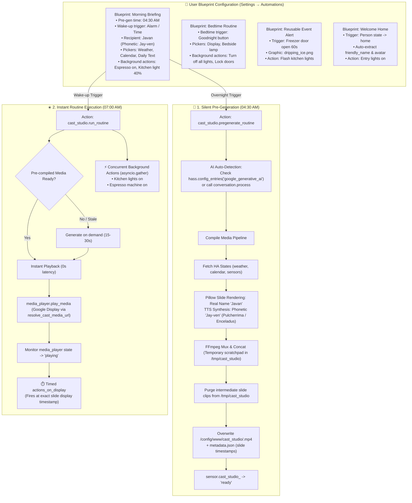

# Design Specification: CastStudio (`ha-cast-studio`)

**Repository Name:** `ha-cast-studio`  
**Integration Domain:** `cast_studio`  
**Target Platform:** Home Assistant Core / Supervised / OS 2024.6.0+ (HACS Custom Integration)  
**Author / Codeowner:** Javan Dicks ([@javand](https://github.com/javand))  
**Document Status:** Approved Design  
**Created:** October 17, 2026  

---

## 1. Executive Summary & Problem Statement

Home Assistant users often want synchronized, multi-sensory routines (morning briefings, bedtime wind-downs, leaving home, arriving home) that combine:
- High-contrast visual slides and graphics rendered for smart displays (e.g., Google Nest Hub 7").
- Personalized spoken narration with proper phonetic name pronunciation and dual-voice personalities.
- Physical device actions (adjusting lights, climate, locks, switches).

Previously, compiling multi-slide briefing media required external host scripts or editing complex YAML files by hand, while forcing users to register separate API keys and secrets. Furthermore, compiling dynamic video takes 15–30 seconds, causing an unacceptable delay if generated on-demand at wake-up.

**The Solution:** Build **`CastStudio`** (`cast_studio`), an autonomous, native Home Assistant custom integration featuring:
1. **3-Tier Production Architecture:**
   - **Static Reusable Clips (0s latency):** Pre-compiled permanent alert MP4s (e.g. freezer door left open, leak alert, garage open) with static or custom graphic icons.
   - **Pre-Generated Daily Shows (0s wake-up latency):** Silently pre-compiles media overnight (04:30 AM) so morning and bedtime shows start instantly.
   - **On-Demand Dynamic Greetings:** On-the-fly personalized arrival greetings (`welcome_home.yaml`) with avatar composition.
2. **Blueprint-First UI Setup:** Ships 4 pre-packaged automation blueprints (`blueprints/automation/cast_studio/`) allowing users to configure complete routines 100% through Home Assistant's visual UI.
3. **Zero-Credential AI Auto-Detection:** Automatically discovers existing Home Assistant AI integrations (such as the official `google_generative_ai` config entry) or routes through native `conversation.*` agents (`conversation.process`), eliminating the need for users to re-enter API keys.
4. **Decoupled Pre-generation:** Silently pre-compiles media ahead of time without waking the house or touching devices, enabling instant, zero-latency playback when triggers occur.
5. **Action Partitioning:** Non-visual background actions (espresso machines, lights, locks) fire concurrently in parallel (`asyncio.gather`), while visual-linked actions execute at the precise moment their slide appears during playback.
6. **Strict Identity Contract:** Visual cards render the user's real name (`name`, e.g. "Javan"), while TTS narration scripts use the phonetic spelling (`phonetic_name`, e.g. "Jay-ven") so speech synthesis pronounces it perfectly.
7. **Mindful Storage Management:** Overwrites target media files by default (`/config/www/cast_studio/<routine>.mp4` and `/config/www/cast_studio/static/<clip>.mp4`), purges scratch clips immediately upon concatenation, and prunes residual dynamic files older than 24 hours while permanently preserving static clips.
8. **Local FFmpeg & Cast Playback:** Generates standard 1024x600 MP4s using Pillow and HA's local FFmpeg binary, casting seamlessly to Google Cast displays via resolved HTTP network URLs (`http://<ha-ip>:8123/local/...`).

---

## 2. System Architecture & Lifecycle Workflow



---

## 3. Blueprint Specification & User Experience

Blueprints are stored under `blueprints/automation/cast_studio/`:

1. **`morning_briefing.yaml`** (Daily Morning Show):
   - Pregeneration schedule (04:30 AM), wake trigger, weather, calendar, tasks, scripture, dual-voice personas, and concurrent smart home actions.
2. **`bedtime_routine.yaml`** (Daily Evening Wind-Down):
   - Evening trigger, bedtime voice styling, bedside display dimming, and concurrent shutdown actions.
3. **`event_alert.yaml`** (Reusable Static Visual Alert):
   - Pre-compiles permanent alert video (`/config/www/cast_studio/static/<clip>.mp4`), fires immediately upon trigger with zero rendering delay.
4. **`welcome_home.yaml`** (Personalized Contextual Arrival):
   - Monitors `person_entity` state transitioning to `home`, extracts `friendly_name` and `entity_picture`, and plays a personalized welcome greeting on smart displays.

---

## 4. Custom Integration Directory Structure

```
ha-cast-studio/
├── blueprints/
│   └── automation/
│       └── cast_studio/
│           ├── morning_briefing.yaml # Morning briefing blueprint
│           ├── bedtime_routine.yaml  # Bedtime routine blueprint
│           ├── event_alert.yaml      # Static reusable alert blueprint
│           └── welcome_home.yaml     # Welcome home arrival blueprint
├── custom_components/
│   └── cast_studio/
│       ├── brand/                    # HA Brands compliant icons and logos
│       ├── assets/                   # Bundled graphics (dripping_ice, door_alert, avatar)
│       ├── __init__.py               # Setup, services, reload, and entry management
│       ├── manifest.json             # Integration metadata & dependencies
│       ├── const.py                  # Domain constants, defaults, voice mappings
│       ├── config_flow.py            # Optional UI config flow (override keys / recipient profile)
│       ├── orchestrator.py           # Routine executor, action partitioner, and Cast sync
│       ├── generator.py              # Core video, static clip, TTS, and slide engine
│       ├── slide_renderer.py         # Pillow image layout & typography renderer (real name)
│       ├── tts_client.py             # Dual-voice TTS synthesizer (phonetic pronunciation)
│       ├── ai_client.py              # AI client with auto-detection & conversation agent support
│       ├── ffmpeg_runner.py          # Native FFmpeg subprocess executor
│       ├── storage_manager.py        # Scratch cleanup & retention pruner (preserves static/)
│       ├── sensor.py                 # Status entities: sensor.cast_studio_<routine>
│       ├── services.yaml             # Service definitions (run_routine, pregenerate, compile_clip)
│       └── strings.json              # UI localization strings
├── tests/
│   ├── conftest.py                   # Pytest fixtures and mocks
│   ├── test_config_flow.py           # Config flow unit tests
│   ├── test_ai_autodetect.py         # Credentials auto-detection tests
│   ├── test_orchestrator.py          # Action partitioning & Cast sync tests
│   ├── test_generator.py             # Video generator and static clip tests
│   ├── test_slide_renderer.py        # Pillow layout & image composition tests
│   ├── test_storage_manager.py       # Cleanup, overwrite, and static retention tests
│   ├── test_tts_client.py            # TTS API mocking tests
│   ├── test_services.py              # Services and sensor lifecycle tests
│   └── test_blueprints.py            # 4-blueprint suite schema validation tests
├── hacs.json                         # HACS integration metadata
├── pyproject.toml                    # Build configuration
├── LICENSE                           # MIT License
└── README.md                         # Installation & usage documentation
```

---

## 5. Technical Specifications

### 5.1. Integration Manifest (`manifest.json`)
```json
{
  "domain": "cast_studio",
  "name": "CastStudio",
  "codeowners": ["@javand"],
  "config_flow": true,
  "documentation": "https://github.com/javand/ha-cast-studio",
  "iot_class": "cloud_polling",
  "issue_tracker": "https://github.com/javand/ha-cast-studio/issues",
  "dependencies": ["ffmpeg"],
  "requirements": ["pillow>=10.2.0"],
  "version": "0.1.0"
}
```

### 5.2. Service Definitions (`services.yaml`)
1. **`cast_studio.run_routine`**: Executes a multimedia routine or static clip with instant playback.
2. **`cast_studio.pregenerate_routine`**: Silently compiles media ahead of time.
3. **`cast_studio.compile_clip`**: Compiles a static reusable alert video clip directly into `/config/www/cast_studio/static/<clip_name>.mp4`.
4. **`cast_studio.reload`**: Reloads integration configuration and resets routine sensors.
