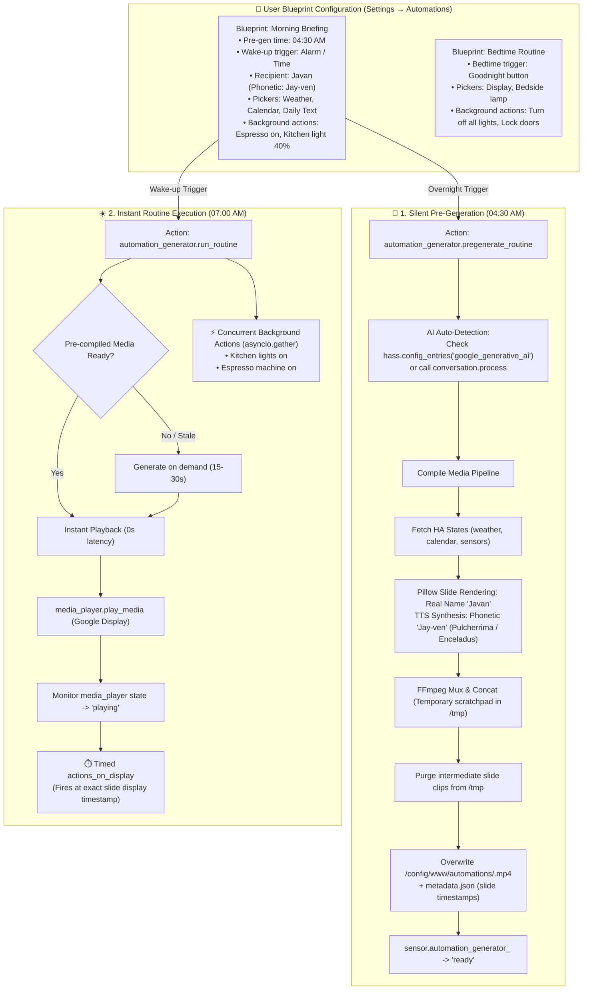

# Design Specification: Home Assistant Automation Generator (`ha-automation-generator`)

**Repository Name:** `ha-automation-generator`  
**Integration Domain:** `automation_generator`  
**Target Platform:** Home Assistant Core / Supervised / OS (HACS Custom Integration)  
**Author / Codeowner:** Javan Dicks ([@javand](https://github.com/javand))  
**Document Status:** Approved Design  
**Created:** October 17, 2026  

---

## 1. Executive Summary & Problem Statement

Home Assistant users often want synchronized, multi-sensory routines (morning briefings, bedtime wind-downs, leaving home, arriving home) that combine:
- High-contrast visual slides rendered for smart displays (e.g., Google Nest Hub 7").
- Personalized spoken narration with proper phonetic name pronunciation and dual-voice personalities.
- Physical device actions (adjusting lights, climate, locks, switches).

Previously, compiling multi-slide briefing media required external host scripts or editing complex YAML files by hand, while forcing users to register separate API keys and secrets. Furthermore, compiling dynamic video takes 15–30 seconds, causing an unacceptable delay if generated on-demand at wake-up.

**The Solution:** Build **`ha-automation-generator`** (`automation_generator`), an autonomous, native Home Assistant custom integration featuring:
1. **Blueprint-First UI Setup:** Ships pre-packaged automation blueprints (`blueprints/automation/automation_generator/`) allowing users to configure complete morning and bedtime routines 100% through Home Assistant's visual UI (using native entity pickers and action builders).
2. **Zero-Credential AI Auto-Detection:** Automatically discovers existing Home Assistant AI integrations (such as the official `google_generative_ai` config entry) or routes through native `conversation.*` agents (`conversation.process`), eliminating the need for users to re-enter API keys.
3. **Decoupled Pre-generation:** Silently pre-compiles media ahead of time (e.g. overnight at 04:30 AM) without waking the house or touching devices, enabling instant, zero-latency playback when wake-up or bedtime triggers occur.
4. **Action Partitioning:** Non-visual background actions (espresso machines, lights, locks) fire concurrently in parallel (`asyncio.gather`), while visual-linked actions execute at the precise moment their slide appears during playback.
5. **Real Name Display with Phonetic TTS:** Visual cards render the user's real name (`name`, e.g. "Javan"), while TTS narration scripts use the phonetic spelling (`phonetic_name`, e.g. "Jay-ven") so speech synthesis pronounces it perfectly.
6. **Mindful Storage Management:** Overwrites target media files by default (`/config/www/automations/<routine>.mp4`), purges scratch clips immediately upon concatenation, and prunes any residual files older than 24 hours to prevent disk bloat.
7. **Local FFmpeg & Cast Playback:** Generates standard 1024x600 MP4s using Pillow and HA's local FFmpeg binary, casting seamlessly to Google Cast displays (synchronized video + audio) and smart speakers (audio-optimized).

---

## 2. System Architecture & Lifecycle Workflow



---

## 3. Blueprint Specification & User Experience

Blueprints are stored under `blueprints/automation/automation_generator/` and automatically made available via HACS.

### 3.1. Morning Briefing Blueprint (`morning_briefing.yaml`)
- **Inputs:**
  - **`pregenerate_time`** (Time, default: `04:30:00`): Time to silently pre-compile the video.
  - **`wake_trigger`** (Trigger selector): Alarm entity, motion sensor, or wake-up time.
  - **`recipient_name`** (Text, default: `Javan`): User's real name to display on visual cards.
  - **`phonetic_name`** (Text, default: `Jay-ven`): Phonetic spelling strictly for TTS pronunciation.
  - **`target_player`** (Target `media_player`): Google Nest Hub or Cast display.
  - **`weather_entity`** (Entity `weather`): e.g., `weather.pirateweather`.
  - **`calendar_entities`** (Entity list `calendar`): Calendars to summarize.
  - **`todo_entity`** (Entity `todo`, optional): Task list to display.
  - **`scripture_sensor`** (Entity `sensor`, optional): Daily text sensor.
  - **`host_voice`** (Select: `Pulcherrima`, `Enceladus`, etc., default: `Pulcherrima`): Speaker voice for weather, calendar, and task slides.
  - **`host_personality`** (Text/Select, default: `news_anchor`): Delivery style for the host voice (e.g., `news_anchor`, `upbeat_energetic`, `conversational`).
  - **`scripture_voice`** (Select: `Enceladus`, `Pulcherrima`, etc., default: `Enceladus`): Speaker voice for daily text and closing thoughts.
  - **`scripture_personality`** (Text/Select, default: `life_coach`): Delivery style for scripture (e.g., `life_coach`, `reverent`, `warm_uplifting`).
  - **`conversation_agent`** (Conversation agent selector, optional): Defaults to auto-detected AI.
  - **`background_actions`** (Action selector): Custom smart home actions to run immediately on wake-up (espresso machine, kitchen lights).

### 3.2. Bedtime Routine Blueprint (`bedtime_routine.yaml`)
- **Inputs:**
  - **`bedtime_trigger`** (Trigger selector): Bedtime button, NFC tag, or time.
  - **`recipient_name`** (Text): Real name for visual cards.
  - **`phonetic_name`** (Text): Phonetic spelling for TTS pronunciation.
  - **`target_player`** (Target `media_player`): Bedroom smart display or speaker.
  - **`bedtime_voice`** (Select: `Enceladus`, `Pulcherrima`, etc., default: `Enceladus`): Voice for evening wind-down.
  - **`bedtime_personality`** (Text/Select, default: `calm_reassuring`): Delivery style for bedtime narration (e.g., `calm_reassuring`, `soothing`, `meditative`).
  - **`background_shutdown_actions`** (Action selector): Actions to execute concurrently (turn off all lights, lock doors, lower thermostat).
  - **`night_display_action`** (Action selector, optional): Bedside lamp dimming synchronized with display wind-down.

---

## 4. Custom Integration Directory Structure

```
ha-automation-generator/
├── blueprints/
│   └── automation/
│       └── automation_generator/
│           ├── morning_briefing.yaml # Morning briefing blueprint
│           └── bedtime_routine.yaml  # Bedtime routine blueprint
├── custom_components/
│   └── automation_generator/
│       ├── __init__.py               # Setup, services, reload, and entry management
│       ├── manifest.json             # Integration metadata & dependencies
│       ├── const.py                  # Domain constants, defaults, voice mappings
│       ├── config_flow.py            # Optional UI config flow (override keys / recipient profile)
│       ├── orchestrator.py           # Routine executor, action partitioner, and Cast sync
│       ├── generator.py              # Core video, TTS, and slide generation engine
│       ├── slide_renderer.py         # Pillow image layout & typography renderer (real name)
│       ├── tts_client.py             # Dual-voice TTS synthesizer (phonetic pronunciation)
│       ├── ai_client.py              # AI client with auto-detection & conversation agent support
│       ├── ffmpeg_runner.py          # Native FFmpeg subprocess executor
│       ├── storage_manager.py        # Scratch cleanup & 24h retention pruner
│       ├── sensor.py                 # Status entities: sensor.automation_generator_<routine>
│       ├── services.yaml             # Service definitions (pregenerate_routine, run_routine)
│       └── strings.json              # UI localization strings
├── tests/
│   ├── conftest.py                   # Pytest fixtures and mocks
│   ├── test_config_flow.py           # Config flow unit tests
│   ├── test_ai_autodetect.py         # Credentials auto-detection tests
│   ├── test_orchestrator.py          # Action partitioning & routine tests
│   ├── test_generator.py             # Video generator unit tests
│   ├── test_slide_renderer.py        # Pillow layout tests
│   ├── test_storage_manager.py       # Cleanup & overwrite tests
│   └── test_tts_client.py            # TTS API mocking tests
├── docs/
│   ├── superpowers/
│   │   ├── specs/                    # Architecture and design specs
│   │   └── plans/                    # SDD implementation plans
├── hacs.json                         # HACS integration metadata
├── pyproject.toml                    # Build configuration
├── LICENSE                           # MIT License
└── README.md                         # Installation & usage documentation
```

---

## 5. Technical Specifications

### 5.1. Integration Manifest (`manifest.json`)
```json
{
  "domain": "automation_generator",
  "name": "Automation Generator",
  "codeowners": ["@javand"],
  "config_flow": true,
  "documentation": "https://github.com/javand/ha-automation-generator",
  "integration_type": "service",
  "iot_class": "cloud_polling",
  "issue_tracker": "https://github.com/javand/ha-automation-generator/issues",
  "dependencies": ["ffmpeg"],
  "requirements": ["pillow>=10.2.0"],
  "version": "0.1.0"
}
```

### 5.2. Service Definitions (`services.yaml`)
```yaml
pregenerate_routine:
  name: Pre-generate Routine
  description: Silently compiles slides, synthesizes audio narration, and writes the MP4 video without triggering physical device actions or playing media.
  fields:
    routine:
      name: Routine
      description: The key of the configured routine (e.g. morning, night).
      required: true
      selector:
        text:
    force_regenerate:
      name: Force Regenerate
      description: Recompile even if media was already generated today.
      default: false
      selector:
        boolean:

run_routine:
  name: Run Routine
  description: Executes non-visual background actions concurrently and begins instant playback of the pre-compiled media (compiling on-the-fly only if missing).
  fields:
    routine:
      name: Routine
      description: The key of the configured routine (e.g. morning, night).
      required: true
      selector:
        text:
    target_player:
      name: Target Player
      description: Override the configured target media player.
      required: false
      selector:
        entity:
          domain: media_player
    force_regenerate:
      name: Force Regenerate
      description: Force a fresh on-the-fly recompile before playback.
      default: false
      selector:
        boolean:

reload:
  name: Reload Routines
  description: Reloads YAML routine configurations from configuration.yaml without restarting Home Assistant.
```
