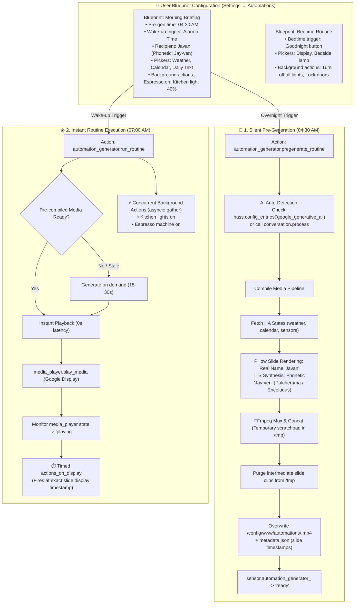

# Superpowers Design Specification: ha-automation-generator

**Document Identifier:** `2026-10-17-ha-automation-generator-design`  
**Date:** October 17, 2026  
**Status:** Approved Specification  
**Author / Codeowner:** Javan Dicks ([@javand](https://github.com/javand))  
**Target Platform:** Home Assistant Core / Supervised / OS (Custom Integration / HACS)  

---

## 1. Intent & Problem Statement

Home Assistant users often want synchronized, multi-sensory morning and evening routines: personalized spoken narration, visual overview slides for smart displays (e.g., Google Nest Hub 7"), and physical device actions (adjusting lights, climate, locks, and media).

Previously, compiling multi-slide briefing media required external host scripts or editing complex YAML files by hand, while forcing users to register separate API keys and secrets. Furthermore, compiling dynamic video takes 15–30 seconds, causing an unacceptable delay if generated on-demand at wake-up.

**The Solution:** `ha-automation-generator` (`automation_generator`) is an autonomous, native Home Assistant custom integration featuring:
1. **Blueprint-First UI Setup:** Ships pre-packaged automation blueprints (`blueprints/automation/automation_generator/`) allowing users to configure complete morning and bedtime routines 100% through Home Assistant's visual UI (using native entity pickers and action builders).
2. **Zero-Credential AI Auto-Detection:** Automatically discovers existing Home Assistant AI integrations (such as the official `google_generative_ai` config entry) or routes through native `conversation.*` agents (`conversation.process`), eliminating the need for users to re-enter API keys.
3. **Decoupled Pre-generation:** Silently pre-compiles media ahead of time (e.g. overnight at 04:30 AM) without waking the house or touching devices, enabling instant, zero-latency playback when wake-up or bedtime triggers occur.
4. **Action Partitioning:** Non-visual background actions (espresso machines, lights, locks) fire concurrently in parallel (`asyncio.gather`), while visual-linked actions execute at the precise moment their slide appears during playback.
5. **Real Name Display with Phonetic TTS:** Visual cards render the user's real name (`name`, e.g. "Javan"), while TTS narration scripts use the phonetic spelling (`phonetic_name`, e.g. "Jay-ven") so speech synthesis pronounces it perfectly.
6. **Mindful Storage Management:** Overwrites target media files by default (`/config/www/automations/<routine>.mp4`), purges scratch clips immediately upon concatenation, and prunes any residual files older than 24 hours to prevent disk bloat.
7. **Local FFmpeg & Cast Playback:** Generates standard 1024x600 MP4s using Pillow and HA's local FFmpeg binary, casting seamlessly to Google Cast displays (synchronized video + audio) and smart speakers (audio-optimized).

---

## 2. Goals, Non-Goals, & Anti-Goals

### 2.1. Goals
- **Blueprint-First Experience:** Distribute ready-to-use blueprints for Morning Briefing and Bedtime Routine that install automatically with the HACS integration.
- **Zero-Credential AI Auto-Detection:**
  - Auto-detect credentials from existing `google_generative_ai` entries in Home Assistant to unlock native Gemini 2.5 Flash and dual voices (`Pulcherrima` + `Enceladus`).
  - Support arbitrary LLM backends via Home Assistant's native `conversation.*` pipeline (`conversation.process`).
  - Provide an optional Config Flow field only as an override.
- **Decoupled Lifecycle with Instant Playback:** Support silent pre-compilation (`pregenerate_routine`) and instant execution (`run_routine`), with automatic fallback on-demand generation if pre-compiled media is missing or stale.
- **Visual vs. Non-Visual Partitioning:**
  - `visual: true` steps generate a visual slide and spoken narration, executing any tied device actions (`actions_on_display`) at the exact timestamp that slide displays.
  - `visual: false` steps execute concurrently in parallel via background tasks (`asyncio.gather`) without inflating video duration.
- **Audio-Only Fallback:** Routines can be flagged `visuals: false` to output lightweight audio files for smart speakers (Nest Mini, Google Home, audio groups).
- **Personalized Recipient Profiles (Visual vs. Phonetic):**
  - **Visual:** Display real name (`name`: `"Javan"`) on all visual slides, titles, and card headers.
  - **Spoken:** Pass phonetic pronunciation (`phonetic_name`: `"Jay-ven"`) to TTS prompts so speech synthesis accurately pronounces the name without spelling errors appearing on-screen.
- **Mindful Storage Management:**
  - Routines overwrite a fixed target file (`/config/www/automations/<routine>.mp4`) by default.
  - Temporary rendering scratchpads (per-slide JPEGs, audio clips, concat lists) in `/tmp/automation_generator/` are deleted immediately after final MP4 compilation.
  - Automated cleanup prunes any historical media or metadata older than 24 hours.
- **100% Native HA Execution:** Zero external host dependencies; all blocking I/O (PIL, FFmpeg) runs in the HA executor pool.

### 2.2. Non-Goals
- Requiring users to configure external cron jobs or host scripts.
- Requiring manual YAML editing for standard users (blueprints handle the UI).
- Real-time video transcoding on-the-fly (videos are pre-compiled into static MP4s).

### 2.3. Anti-Goals
- **Forcing Duplicate API Keys:** Never force users to create or re-enter API keys when an AI integration is already functioning in Home Assistant.
- **Displaying Phonetic Spellings on Screen:** Never show phonetic spellings (`Jay-ven`) in visible slide typography; phonetic spellings are strictly for the TTS audio generator.
- **Uncontrolled Storage Growth:** Never leave orphan temporary clips or accumulate endless gigabytes of daily video files on Home Assistant storage.
- **Blocking the Event Loop:** Never run Pillow drawing, file writes, or FFmpeg subprocesses directly on the HA main async loop.
- **Serializing Non-Visual Actions:** Non-visual smart home actions must never artificially block or elongate the media playback timeline.

---

## 3. System Architecture & Lifecycle Workflow



---

## 4. Blueprint Specification & User Experience

Blueprints are stored under `blueprints/automation/automation_generator/` and automatically made available via HACS.

### 4.1. Morning Briefing Blueprint (`morning_briefing.yaml`)
- **Metadata:**
  - Name: `Automation Generator - Morning Briefing`
  - Domain: `automation`
- **Inputs:**
  - **`pregenerate_time`** (Time, default: `04:30:00`): Time to silently pre-compile the video.
  - **`wake_trigger`** (Trigger selector): Alarm entity, motion sensor, or wake-up time.
  - **`recipient_name`** (Text, default: `Javan`): User's real name to display on visual cards.
  - **`phonetic_name`** (Text, default: `Jay-ven`): Phonetic spelling strictly for TTS pronunciation.
  - **`target_player`** (Target `media_player`): Google Nest Hub or Cast display.
  - **`weather_entity`** (Entity `weather`): e.g., `weather.pirateweather`.
  - **`calendar_entities`** (Entity list `calendar`): Calendars to summarize.
  - **`todo_entity`** (Entity `todo`, optional): Task list to display.
  - **`scripture_sensor`** (Entity `sensor`, optional): Daily text sensor.
  - **`host_voice`** (Select: `Pulcherrima`, `Enceladus`, etc., default: `Pulcherrima`): Speaker voice for weather, calendar, and task slides.
  - **`host_personality`** (Text/Select, default: `news_anchor`): Delivery style for the host voice (e.g., `news_anchor`, `upbeat_energetic`, `conversational`).
  - **`scripture_voice`** (Select: `Enceladus`, `Pulcherrima`, etc., default: `Enceladus`): Speaker voice for daily text and closing thoughts.
  - **`scripture_personality`** (Text/Select, default: `life_coach`): Delivery style for scripture (e.g., `life_coach`, `reverent`, `warm_uplifting`).
  - **`conversation_agent`** (Conversation agent selector, optional): Defaults to auto-detected AI.
  - **`background_actions`** (Action selector): Custom smart home actions to run immediately on wake-up (espresso machine, kitchen lights).

### 4.2. Bedtime Routine Blueprint (`bedtime_routine.yaml`)
- **Inputs:**
  - **`bedtime_trigger`** (Trigger selector): Bedtime button, NFC tag, or time.
  - **`recipient_name`** (Text): Real name for visual cards.
  - **`phonetic_name`** (Text): Phonetic spelling for TTS pronunciation.
  - **`target_player`** (Target `media_player`): Bedroom smart display or speaker.
  - **`bedtime_voice`** (Select: `Enceladus`, `Pulcherrima`, etc., default: `Enceladus`): Voice for evening wind-down.
  - **`bedtime_personality`** (Text/Select, default: `calm_reassuring`): Delivery style for bedtime narration (e.g., `calm_reassuring`, `soothing`, `meditative`).
  - **`background_shutdown_actions`** (Action selector): Actions to execute concurrently (turn off all lights, lock doors, lower thermostat).
  - **`night_display_action`** (Action selector, optional): Bedside lamp dimming synchronized with display wind-down.

---

## 5. Integration Architecture & Directory Structure

```
ha-automation-generator/
├── blueprints/
│   └── automation/
│       └── automation_generator/
│           ├── morning_briefing.yaml # Morning briefing blueprint
│           └── bedtime_routine.yaml  # Bedtime routine blueprint
├── custom_components/
│   └── automation_generator/
│       ├── __init__.py               # Setup, services, reload, and entry management
│       ├── manifest.json             # Integration metadata & dependencies
│       ├── const.py                  # Domain constants, defaults, voice mappings
│       ├── config_flow.py            # Optional UI config flow (override keys / recipient profile)
│       ├── orchestrator.py           # Routine executor, action partitioner, and Cast sync
│       ├── generator.py              # Core video, TTS, and slide generation engine
│       ├── slide_renderer.py         # Pillow image layout & typography renderer (real name)
│       ├── tts_client.py             # Dual-voice TTS synthesizer (phonetic pronunciation)
│       ├── ai_client.py              # AI client with auto-detection & conversation agent support
│       ├── ffmpeg_runner.py          # Native FFmpeg subprocess executor
│       ├── storage_manager.py        # Scratch cleanup & 24h retention pruner
│       ├── sensor.py                 # Status entities: sensor.automation_generator_<routine>
│       ├── services.yaml             # Service definitions (pregenerate_routine, run_routine)
│       └── strings.json              # UI localization strings
├── tests/
│   ├── conftest.py                   # Pytest fixtures and mocks
│   ├── test_config_flow.py           # Config flow unit tests
│   ├── test_ai_autodetect.py         # Credentials auto-detection tests
│   ├── test_orchestrator.py          # Action partitioning & routine tests
│   ├── test_generator.py             # Video generator unit tests
│   ├── test_slide_renderer.py        # Pillow layout tests
│   ├── test_storage_manager.py       # Cleanup & overwrite tests
│   └── test_tts_client.py            # TTS API mocking tests
├── docs/
│   ├── superpowers/
│   │   ├── specs/                    # Architecture and design specs
│   │   └── plans/                    # SDD implementation plans
├── hacs.json                         # HACS integration metadata
├── pyproject.toml                    # Build configuration
├── LICENSE                           # MIT License
└── README.md                         # Installation & usage documentation
```

---

## 6. Zero-Credential AI Auto-Detection & Content Contracts

### 6.1. Credential Discovery Strategy
`ai_client.py` uses a prioritized discovery hierarchy:
1. **Explicit Integration Options:** If the user provided an API key in the optional Config Flow, use it directly.
2. **Auto-Detected Google Generative AI:** Check `hass.config_entries.async_entries("google_generative_ai")`. If found, extract the existing active `api_key`. This instantly unlocks direct Gemini 2.5 Flash API calls and native high-fidelity audio synthesis (`Pulcherrima` and `Enceladus`) with **zero user input**.
3. **Native Conversation Agent:** If no direct Google AI key exists, route requests through Home Assistant's standard `conversation.process` service using the user's configured default or selected conversation entity.

### 6.2. Content Formatting & Recipient Separation
1. Current entity states (weather, calendar agenda, daily scripture) along with recipient profiles are bundled into the AI prompt.
2. The AI returns structured JSON separating visual card text from spoken script:
   ```json
   {
     "visual_card": {
       "title": "Good Morning, Javan!",
       "subtitle": "Saturday, October 17, 2026",
       "bullet_points": ["Sunny, High 72°F", "2 calendar events", "Daily text: Proverbs 3:5"]
     },
     "narration_script": "Good morning, Jay-ven! Today is Saturday, October 17th..."
   }
   ```
3. `slide_renderer.py` draws the visual card with the real name (`Javan`) using Pillow.
4. `tts_client.py` synthesizes the audio using the phonetic script (`Jay-ven`).

### 6.3. Storage Hygiene & Pruning Policy (`storage_manager.py`)
1. **Predictable Target Overwrite:** Videos compile directly to `/config/www/automations/<routine>.mp4`. Subsequent runs overwrite the existing file, avoiding storage buildup.
2. **Immediate Scratchpad Cleanup:** All per-slide temporary JPEGs (`slide_*.jpg`) and audio segments (`clip_*.mp4`) are generated in a temporary scratchpad (`/tmp/automation_generator/<routine_name>/`) and purged immediately following successful concatenation.
3. **Automated Pruning:** Any orphaned clips or metadata files older than 24 hours are automatically removed during the pre-generation lifecycle.

### 6.4. Per-Action Voice Selection & Personality Conditioning
1. **Independent Voice Assignment:** Each step in a routine can specify an independent speaker voice (e.g., `voice: "Pulcherrima"` for weather/calendar, `voice: "Enceladus"` for daily text).
2. **Dynamic Personality Shaping:** Each step supports a `voice_personality` attribute (e.g., `news_anchor`, `life_coach`, `calm_reassuring`, `meditative`).
3. **Synthesis Engine Integration:**
   - In Gemini 2.5 Flash, the voice and personality directives are passed directly to the model conditioning context to modulate speaking rate, inflection, and cadence.
   - In OpenAI / HA Assist fallbacks, `voice_personality` prompts are injected into the LLM script generation prompt to tailor phrasing, rhythm, and tone, before routing to the provider's voice model.

---

## 7. What is Decided vs. Left to the Builder

### 7.1. Decided
- Repository name: `ha-automation-generator`, domain: `automation_generator`.
- Author / Codeowner: Javan Dicks (`@javand`).
- Setup: **Blueprint-first architecture** with auto-installed blueprints in `blueprints/automation/automation_generator/`.
- AI Credentials: **Zero-credential auto-detection** from existing Home Assistant `google_generative_ai` entries or native `conversation.*` agents.
- Lifecycle: Decoupled into silent `pregenerate_routine` (for overnight runs) and instant `run_routine` (for wake-up / bedtime triggers).
- Partitioning: Non-visual actions fire concurrently in background via `asyncio.gather`; visual actions sequence to slide display timestamps.
- Output: Standard MP4 (1024x600, H.264/AAC) + JSON metadata file in `/config/www/automations/`.
- Recipient identity strictly separates real name on screen (`name`) from phonetic spelling in speech synthesis (`phonetic_name`).
- Storage hygiene: Target file overwrite, immediate scratchpad cleanup, and 24h stale file pruning.

### 7.2. Left to the Builder
- Specific internal caching strategy for slide backgrounds and font assets.
- Concrete retry and timeout policies for third-party AI API calls (e.g., 10s timeout with exponential backoff).
